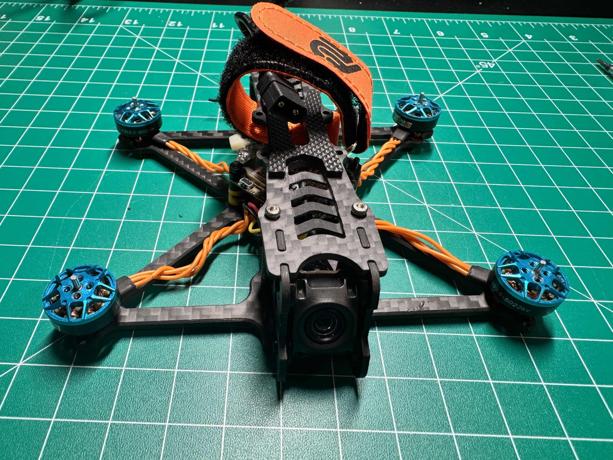
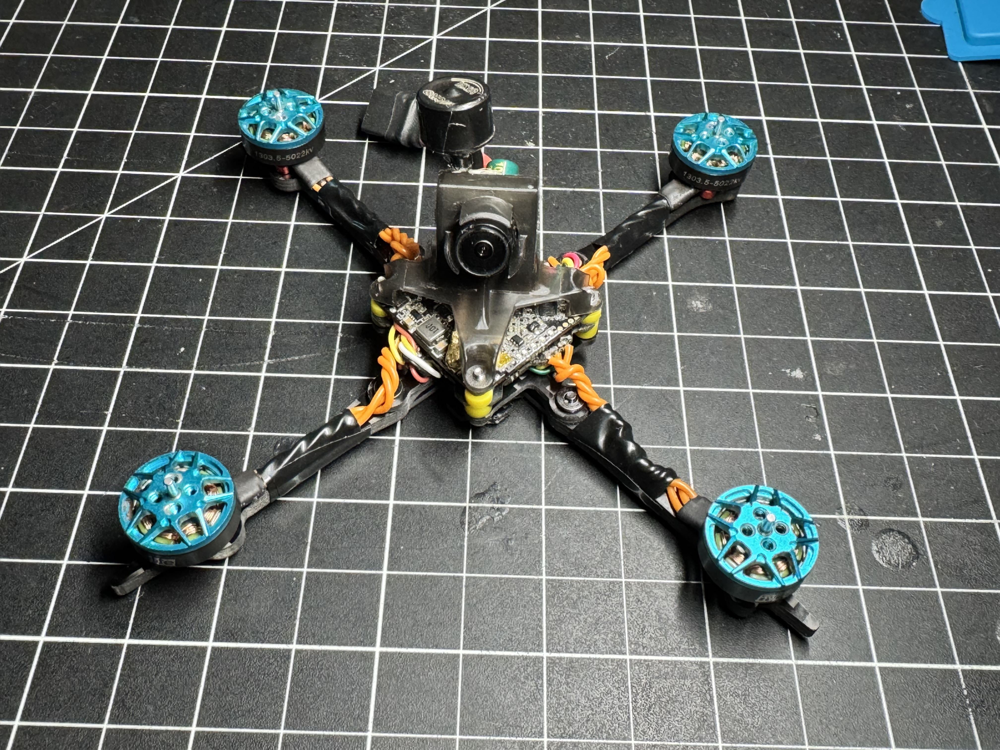
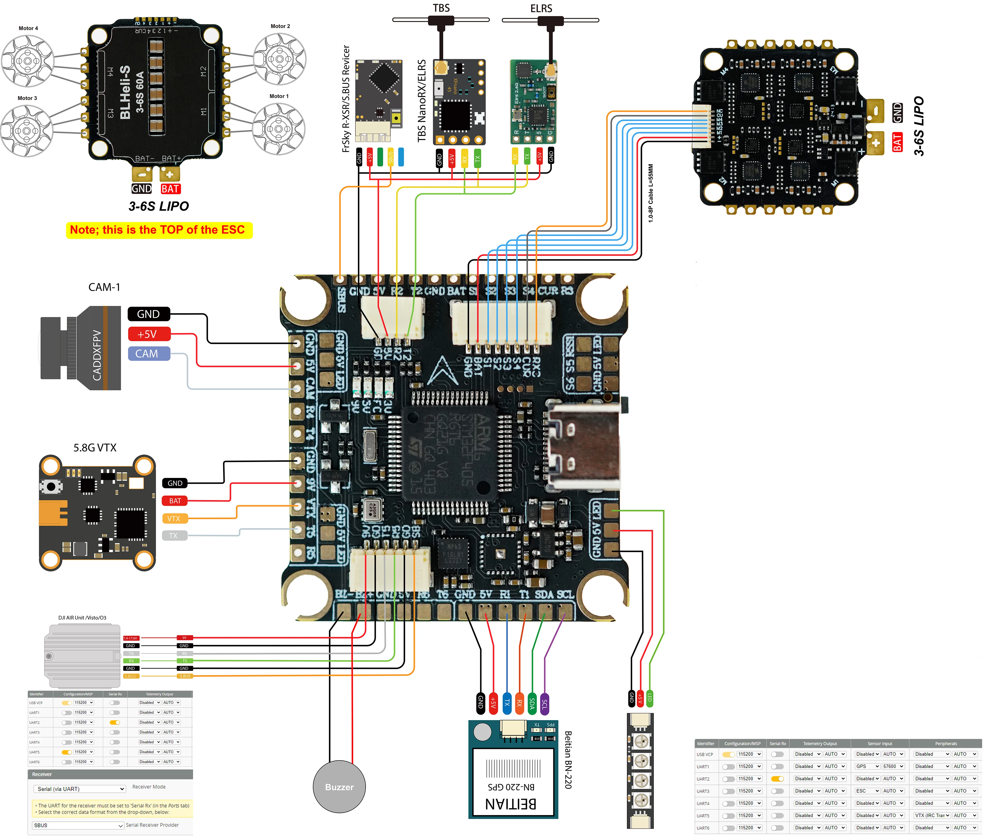
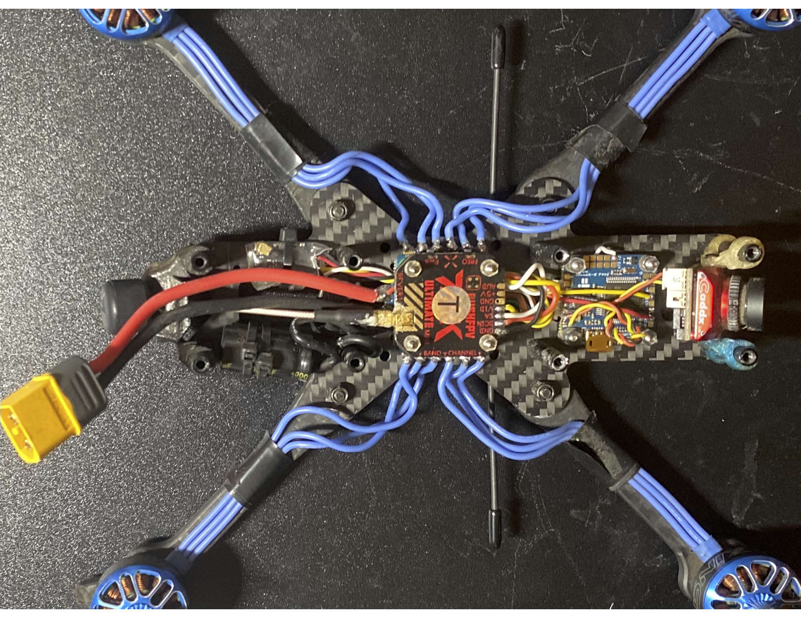

# UAS

Build notes, Betaflight backups, and flight logs for unmanned aircraft.

YouTube: [@stoiczfpv](https://youtube.com/@stoiczfpv)

I post on [Instagram @hectorsvill_uas](https://www.instagram.com/hectorsvill_uas/).

## Builds

| Photo | Build | Status | Summary |
| --- | --- | --- | --- |
|  | [Hyper Digital](builds/hyper-digital/README.md) | On the bench | Digital Hyper: SoloGood 3-inch frame, Darwin F411 AIO, Bluejay, EP2 ELRS, DJI O4 Lite |
|  | [Hyper Analog](builds/hyper/README.md) | In the hangar | 3S toothpick, Kabab TP3, Darwin F411 AIO, Bluejay, EP2 ELRS, VT5804 analog |
|  | [Mark4 7-inch](builds/mark4-7inch/README.md) | On the bench | 7-inch build on a REA Mark4 frame with 2807 1300KV motors, an F405 flight controller, a 60A 4-in-1 ESC, and GPS |
|  | [Glide5](builds/glide5-deprecated/README.md) | Retired | My earlier build, kept for reference with its photo and Betaflight backup |

Status: **On the bench** (in progress) · **In the hangar** (currently flying) · **Retired**.

New build? Start from [builds/TEMPLATE.md](builds/TEMPLATE.md).

Mark4 images: [F405.webp](builds/mark4-7inch/images/F405.webp), [gps-1.webp](builds/mark4-7inch/images/gps-1.webp), [gps-2.webp](builds/mark4-7inch/images/gps-2.webp), [gps3.webp](builds/mark4-7inch/images/gps3.webp), [gps-4.webp](builds/mark4-7inch/images/gps-4.webp).

## Remote ID

I fly recreationally by default and only fly under Part 107 for project work.

Recreational flights fall under the Exception for Limited Recreational Operations (49 USC 44809). On those flights I carry proof of TRUST, follow a community-based organization's safety guidelines, get airspace authorization (LAANC) before flying in controlled airspace, and stay at or below 400 ft AGL in uncontrolled airspace.

If I'm flying recreationally and the aircraft weighs 250 g (0.55 lb) or less all-up, I don't register it and don't broadcast Remote ID. If a recreational aircraft weighs more than 250 g, I register it, mark the registration number on the outside, and broadcast Remote ID with built-in Standard Remote ID or a broadcast module. The only exception is flying at an FAA-Recognized Identification Area (FRIA), where I stay within the boundary and keep the aircraft in sight.

Under Part 107, I register every aircraft and broadcast Remote ID no matter what it weighs.

This is not legal advice. Check the current FAA rules.

- [FAA Remote ID](https://www.faa.gov/uas/getting_started/remote_id)
- [FAA recreational flyers](https://www.faa.gov/uas/recreational_flyers)
- [FAA-Recognized Identification Areas](https://www.faa.gov/uas/getting_started/remote_id/fria)

## Configs

Betaflight backups are in [configs/betaflight/](configs/betaflight/). Each directory uses the name already in the filename.

- [glide5/BTFL_backup_Glide5.json](configs/betaflight/glide5/BTFL_backup_Glide5.json)
- [xl5-v5-native/BTFL_backup_XL5_V5_Native.json](configs/betaflight/xl5-v5-native/BTFL_backup_XL5_V5_Native.json)
- [matekf411](configs/betaflight/matekf411/)
  - [BTFL_cli_backup_20250622_173722_MATEKF411.txt](configs/betaflight/matekf411/BTFL_cli_backup_20250622_173722_MATEKF411.txt)
  - [BTFL_cli_backup_20250623_202435_MATEKF411.txt](configs/betaflight/matekf411/BTFL_cli_backup_20250623_202435_MATEKF411.txt)
- [flight-controllers/jhef7dual](configs/betaflight/flight-controllers/jhef7dual/)
  - [JHEF7DUAL.txt](configs/betaflight/flight-controllers/jhef7dual/JHEF7DUAL.txt)
  - [BTFL_cli_backup_20250621_155700_JHEF7DUAL.txt](configs/betaflight/flight-controllers/jhef7dual/BTFL_cli_backup_20250621_155700_JHEF7DUAL.txt)
- [flight-controllers/furyf4osd](configs/betaflight/flight-controllers/furyf4osd/)
  - [BTFL_cli_backup_20250621_163759_FURYF4OSD.txt](configs/betaflight/flight-controllers/furyf4osd/BTFL_cli_backup_20250621_163759_FURYF4OSD.txt)

## Scripts

Scripts are in [scripts/](scripts/README.md).

- [drone-video-renamer](scripts/drone-video-renamer/README.md) renames SD card videos to `DroneName-YYYY-MM-DD-<time or UUID>.ext`.

## Logs

- [2025](logs/2025.md)

## Previous paths

| Previous path | Current path |
| --- | --- |
| `Mark4-7inch/` | [builds/mark4-7inch/](builds/mark4-7inch/) |
| `Mark4-7inch/build+log.md` | [builds/mark4-7inch/build-log.md](builds/mark4-7inch/build-log.md) |
| `Glide5-Depricated/` | [builds/glide5-deprecated/](builds/glide5-deprecated/) |
| `BTFL_backup/` | [configs/betaflight/](configs/betaflight/) |
| `Flight Log/FLIGHTLOG.md` | [logs/2025.md](logs/2025.md) |
