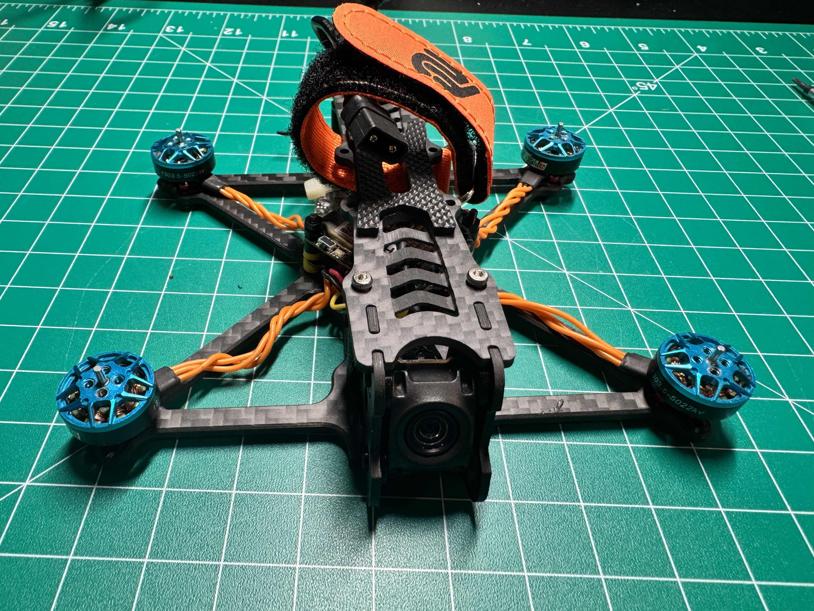

# Hyper Digital

<p align="center">
  
  
</p>

Status: On the bench

Digital version of [Hyper Analog](../hyper/README.md). Uses the same FC, motors, and ExpressLRS EP2 nano as Hyper Analog, on a SoloGood 3-inch frame with a DJI O4 Lite (O4 Air Unit) for digital video, because analog video quality was poor.

| Spec | Detail |
| --- | --- |
| Status | On the bench. Betaflight setup complete 2026-11-20. Bench check (OSD in the goggles, arm, failsafe test), maiden, current calibration, and PID/rates tune still to do |
| Frame | SoloGood 3-inch carbon frame for DJI O4 ([Amazon listing](https://www.amazon.com/dp/B0F1F5YSMS): 3 Inch Micro Carbon Fiber FPV Racing Quadcopter Frame For DJI O4 Air Unit). Wheelbase 135 mm, about 33 g, 14 mm camera bay, FC mounts 25.5×25.5 / 26.5×26.5 / 20×20 mm. 3K carbon; 3 mm bottom plate, 2 mm top plate, 1.5 mm side plates, 24 mm standoffs |
| Motors | Pyrodrone Hyperlite 1303.5 5022KV ×4 (2–4S, discontinued). Same as [Hyper Analog](../hyper/README.md) |
| FC/ESC | DarwinFPV F411 AIO, the same FC as [Hyper Analog](../hyper/README.md). STM32F411, 25.5×25.5 mm mount. ESC 15A continuous / 17A burst, EFM8BB21, Bluejay 0.21.0 on layout S-H-50 (was BLHeli_S 16.7). 1–3S only. 5V/2A BEC. See [Hyper Analog](../hyper/README.md) for the ESC setup |
| VTX | DJI O4 Lite (O4 Air Unit), stock camera. MSP DisplayPort on UART2. Power from VBAT |
| RX | ExpressLRS 2.4 GHz EP2 RX nano (SX1280) on UART1 via CRSF. Same as [Hyper Analog](../hyper/README.md) |
| Battery | 3S, capacity TBD. Do not run the O4 Lite on 4S |
| Props | 3-inch 2-blade, 3018/3020 class. 5022KV is high for aggressive triblades on 3S |
| AUW | TBD. I will weigh it before the first flight. On a recreational flight, 250 g (0.55 lb) or less means I don't register or broadcast Remote ID. More than 250 g means I register, mark, and broadcast, or fly at a FRIA. |
| Operating mode | Recreational by default. I only fly this aircraft under Part 107 for a project. |
| Remote ID | I have not chosen the hardware yet. If I fly it recreationally at 250 g (0.55 lb) or less, I don't register it and don't broadcast Remote ID. If it weighs more than 250 g, I register it, mark the registration number on the outside, and broadcast with built-in Standard Remote ID or a module, unless I fly at a FRIA, stay inside the boundary, and keep it in sight. Under Part 107 I register and broadcast at any weight. |
| Betaflight config | See Betaflight & ESC setup and Full CLI config below (2026-11-20 `diff all`). Link `configs/betaflight/hyper-digital/` here if I add a file copy |
| Brain note | The full parts list with prices lives in my private notes |

## Firmware

I flashed Betaflight 2026.6.2, target MATEKF411 (community target) on the Darwin F411 AIO, with full chip erase. Build options include HD OSD (MSP DisplayPort) for the O4 Lite, CRSF, and DShot/telemetry. SmartAudio/Tramp not needed. The DARWINF411 target did not detect the gyro; use MATEKF411.

## Wiring

The O4 Lite 3-in-1 cable has no solder pads at the air-unit end, so I cut the FC end and solder it to the pads the VT5804 used on [Hyper Analog](../hyper/README.md). Pinout is from the [DJI O4 Air Unit Series user manual](https://dl.djicdn.com/downloads/DJI_O4_Air_Unit_Series/UM/DJI_O4_Air_Unit_Series_User_Manual_v1.0_en.pdf). TX goes to RX, so the O4's white wire lands on TX2. I'll check the pad labels on the board before I solder.

| O4 wire | Signal | Darwin F411 pad |
| --- | --- | --- |
| Red | VCC (3.7–13.2 V) | VBAT (the old VTX power pad) |
| Black | Power GND | GND |
| White | O4 RX | TX2 (where SmartAudio was) |
| Grey | O4 TX | RX2 |
| Brown | Signal GND | Not connected |
| Yellow | S.Bus | Not connected (I'm on ELRS) |

The O4 Lite input is 3.7–13.2 V, so a full 3S pack at 12.6 V on VBAT is within spec. Never run it on 4S. I'll add a low-ESR 220–470 µF, 25 V cap on the battery leads to soak up voltage spikes.

## Betaflight setup

Recorded 2026-11-20.

- Backup: I skipped a fresh `diff`. The baseline is [Hyper Analog](../hyper/README.md)'s full CLI config. The FC is now mounted in normal orientation (not upside down), so board roll is 0 and Hyper Analog's motor remap does not carry over.
- Flash: Betaflight 2026.6.2, target MATEKF411 (community target), full chip erase. Build options include HD OSD (MSP DisplayPort) for the O4 Lite, CRSF, and DShot/telemetry. SmartAudio/Tramp not needed.
- Setup: I applied custom defaults, calibrated the accelerometer, and left board alignment at 0. UART1 is Serial RX (ELRS EP2, CRSF). UART2 is Peripherals "VTX (MSP + Displayport)" for the O4 Lite; no Configuration/MSP toggle needed. Motor resources are stock: MOTOR 1 B04, 2 B05, 3 B06, 4 B07. UART1 is A09/A10, UART2 is A02/A03.
- Motors: I checked and fixed motor order and direction (props-in).
- Receiver/modes: CRSF, AETR1234, sticks verified. Arm on AUX1, Flip over after crash on AUX2. `set small_angle = 180` so it can arm upside down for turtle.
- CPU/rates: `status` shows CPU 24%, gyro 8 kHz, OSD: MSP (53 x 20).

```
set pid_process_denom = 4
set gyro_lpf2_static_hz = 0
set dyn_notch_count = 1
set dshot_bidir = ON
set motor_poles = 12
rateprofile 0
set rates_type = ACTUAL
set roll_rc_rate = 20
set pitch_rc_rate = 20
set roll_srate = 67
set pitch_srate = 67
set yaw_srate = 60
set roll_expo = 54
set pitch_expo = 54
save
```

- OSD: HD, O4 Lite Canvas mode in the goggles.
  - On: battery voltage, average cell voltage, link quality, RSSI dBm, flight timer, warnings, flight mode, mAh drawn (once the current sensor is calibrated).
  - Off: crosshair, craft name, artificial horizon, home arrow/GPS items, throttle/PID/rate readouts.
  - Alarms: RSSI dBm -100, LQ 70%. `set vbat_warning_cell_voltage = 340`. Land around 10.5 V at rest on 3S.
- Failsafe: Stage 2 = Drop (no GPS), guard time 1.0 s. I kept the defaults / these settings as set:

```
set failsafe_delay = 15
save
```

  Test (props off), to run before maiden (not yet confirmed): arm, switch the radio off; motors should stop within about 1.5 s and the OSD should show FAILSAFE. Turn the radio back on and confirm it will not re-arm until I toggle the arm switch. Repeat this test before each maiden after config changes.

### Current sensor (mAh) calibration

On the Power & Battery tab, set the current meter source to Onboard ADC. Fly a full pack and note the OSD mAh. Recharge and note the charger mAh. New scale = current scale × (OSD mAh / charger mAh). Then:

```
set ibata_scale = <new value>
save
```

Repeat until it's within about 5%.

### Next

- Bench check: OSD in the goggles, arm, failsafe test
- Maiden
- Current sensor (mAh) calibration
- PID/rates tune

## Betaflight & ESC setup

Recorded 2026-11-20.

### Firmware

- Betaflight 2026.6.2, target MATEKF411 (community target) on the Darwin F411 AIO
- Build options include HD OSD (MSP DisplayPort) for the O4 Lite, CRSF, and DShot/telemetry. SmartAudio/Tramp not needed
- Full chip erase before flash

### Board alignment and motor remap

- FC is mounted in normal orientation (not upside down)
- Board alignment is 0. Hyper Analog's `align_board_roll = 180` and motor remap do not carry over
- Motor resources are stock: MOTOR 1 B04, 2 B05, 3 B06, 4 B07
- UART1 is A09/A10, UART2 is A02/A03

### Ports

| Port | Setting |
| --- | --- |
| USB VCP | MSP on |
| UART1 | Serial RX (ELRS EP2, CRSF) |
| UART2 | Peripherals "VTX (MSP + Displayport)" for the O4 Lite. No Configuration/MSP toggle needed |

### Modes

- CRSF, AETR1234, sticks verified
- Arm on AUX1 (1700–2100)
- Flip over after crash (turtle) on AUX2 (1700–2100)
- `small_angle` 180 so it can arm upside down for turtle
- Additional modes from the 2026-11-20 `diff all` are in Full CLI config (`aux 1` mode 13 on AUX5, `aux 2` mode 19 on AUX3)

### VTX

- Model: DJI O4 Lite (O4 Air Unit)
- Control: MSP DisplayPort on UART2
- Power source: VBAT
- Remove the analog VTX table
- In the goggles, set the O4 OSD to Canvas mode (HD)

### Betaflight changes vs Hyper Analog

UART2 is set in the Ports tab as Peripherals "VTX (MSP + Displayport)" (`serial UART2 131073` in the 2026-11-20 `diff all`). Delete the analog VTX table, and set the goggles OSD to Canvas mode. The full command list is in Full CLI config below.

### CPU load

`status` shows CPU 24%, gyro 8 kHz, OSD: MSP (53 x 20). Current filter settings: `pid_process_denom = 4`, `gyro_lpf2_static_hz = 0`, `dyn_notch_count = 1`.

### Rates

Actual, rateprofile 0: roll/pitch `rc_rate` 20, `srate` 67, yaw `srate` 60, roll/pitch expo 54. PIDs are still defaults. See PIDs & rates below.

### ESC

Same Bluejay setup as [Hyper Analog](../hyper/README.md): Bluejay 0.21.0 at 48 kHz, layout S-H-50. I checked and fixed motor order and direction (props-in). `motor_poles = 12`.

### Bidirectional DShot

`dshot_bidir = ON`, `motor_poles = 12`.

### Still to do

See Next steps below.

## Next steps

- Bench check: OSD in the goggles, arm, failsafe test
- Maiden
- Current sensor (mAh) calibration
- PID/rates tune

## Photos

I store photos in the `images/` folder next to this README and link them with relative paths; I keep each image under ~1 MB.

<p align="center">
  
  
</p>

## Parts list (copy/paste)

Caption I can paste to Instagram or X:

```text
Hyper Digital 3S
Frame: SoloGood 3-inch carbon (DJI O4)
FC/ESC: DarwinFPV F411 AIO 15A (Bluejay 0.21.0)
Motors: Pyrodrone Hyperlite 1303.5 5022KV
RX: ELRS EP2 nano
VTX: DJI O4 Lite (stock camera)
Firmware: Betaflight 2026.6.2
Battery: 3S
Props: 3-inch 2-blade, 3018/3020 class
#fpv #fpvdrone #dji #o4lite #betaflight #expresslrs
```

## Build log

- 2026-11-19: Planned. Digital version of [Hyper Analog](../hyper/README.md) on the SoloGood 3-inch frame with a DJI O4 Lite. Uses the same FC, motors, and EP2 receiver as Hyper Analog.
- 2026-11-20: Betaflight setup complete. I mounted the FC in normal orientation, flashed Betaflight 2026.6.2 (MATEKF411, HD OSD), applied custom defaults, calibrated the accelerometer, and set UART1 to Serial RX and UART2 to VTX (MSP + Displayport). Motor resources are stock. I checked and fixed motor order and direction (props-in), set Arm on AUX1 and Flip over after crash on AUX2 with `small_angle` 180, applied CPU/rates, HD OSD, and failsafe settings, and saved a `diff all`. Next: bench check (OSD in the goggles, arm, failsafe test), maiden, current calibration, and PID/rates tune.

## Links

- [SoloGood 3-inch carbon frame for DJI O4](https://www.amazon.com/dp/B0F1F5YSMS)
- [DJI O4 Air Unit Series user manual](https://dl.djicdn.com/downloads/DJI_O4_Air_Unit_Series/UM/DJI_O4_Air_Unit_Series_User_Manual_v1.0_en.pdf)
- [DJI Goggles 3 pairing and streaming](../../gear/dji-goggles-3/README.md) (PR #8)
- [Hyper Analog](../hyper/README.md)
- [Hyperlite 1303.5 5022KV (archived listing)](https://web.archive.org/web/20230201022401/https://pyrodrone.com/products/hyperlite-1303-5-fpv-drone-motor-5022kv)

## PIDs & rates

PIDs are Betaflight 2026.6.2 defaults (untuned). Rates from the 2026-11-20 `diff all`, rateprofile 0: roll/pitch `rc_rate` 20, expo 54, yaw `srate` 60. Roll/pitch `srate` 67 and `rates_type` ACTUAL were set and are defaults, so they do not appear in the diff.

Dump current values. Betaflight CLI `get` does a substring match, so these work:

```
profile 0
get p_
get i_
get d_
get f_
get d_max
rateprofile 0
get rc_rate
get srate
get expo
get rates_type
```

`diff profile` and `diff rates` show only changed values.

Current PID/rates diff:

```
# PIDs: defaults (paste diff profile here after tuning)
rateprofile 0
set roll_rc_rate = 20
set pitch_rc_rate = 20
set roll_expo = 54
set pitch_expo = 54
set yaw_srate = 60
```

## Full CLI config

Reproduce this config from a fresh Betaflight 2026.6.2 MATEKF411 flash. `defaults` is not needed after a full chip erase. This is the 2026-11-20 `diff all` with `mcu_id`, the empty `signature` line, and `acc_calibration` removed. Calibrate the accelerometer after pasting. ESC direction is set in ESC Configurator, not CLI. Board alignment is 0 and motor resources are stock; do not paste Hyper Analog's remap. `small_angle` 180 is intentional; turtle mode (flip over after crash, AUX2) also arms upside down by itself. `ibata_scale` is still the default until I calibrate the current sensor.

```
# Betaflight 2026.6.2, MATEKF411
batch start
defaults nosave
board_name MATEKF411
manufacturer_id MTKS
feature TELEMETRY
feature OSD
serial UART1 64 115200 57600 0 115200
serial UART2 131073 115200 57600 0 115200
aux 0 0 0 1700 2100 0 0
aux 1 13 4 1700 2100 0 0
aux 2 19 2 1700 2100 0 0
aux 3 35 1 1700 2100 0 0
set gyro_lpf2_static_hz = 0
set dyn_notch_count = 1
set dshot_bidir = ON
set motor_poles = 12
set small_angle = 180
set pid_process_denom = 4
set osd_link_quality_alarm = 70
set osd_rssi_dbm_alarm = -100
set osd_vbat_pos = 512
set osd_link_quality_pos = 2532
set osd_tim_2_pos = 2592
set osd_mah_drawn_pos = 2625
set osd_avg_cell_voltage_pos = 2560
profile 0
rateprofile 0
set roll_rc_rate = 20
set pitch_rc_rate = 20
set roll_expo = 54
set pitch_expo = 54
set yaw_srate = 60
save
```
