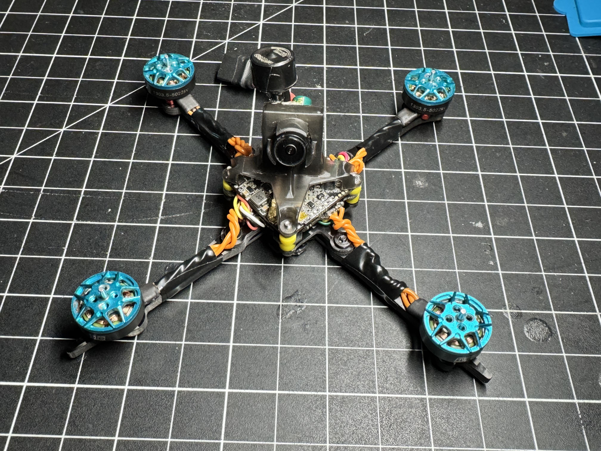
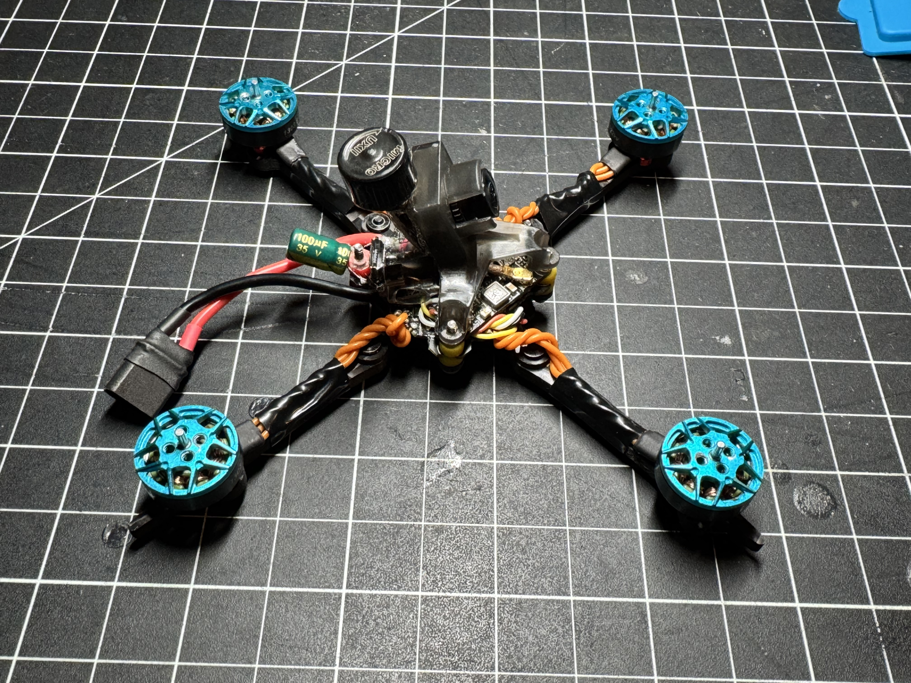
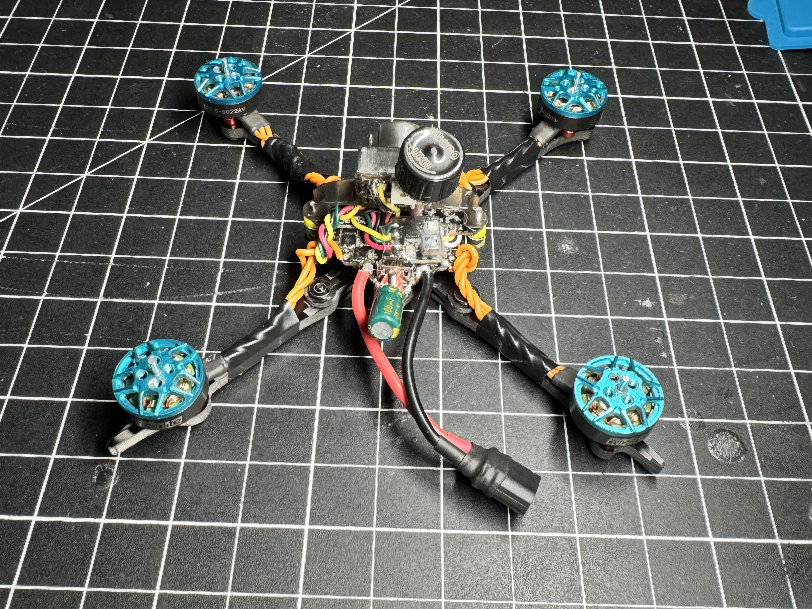
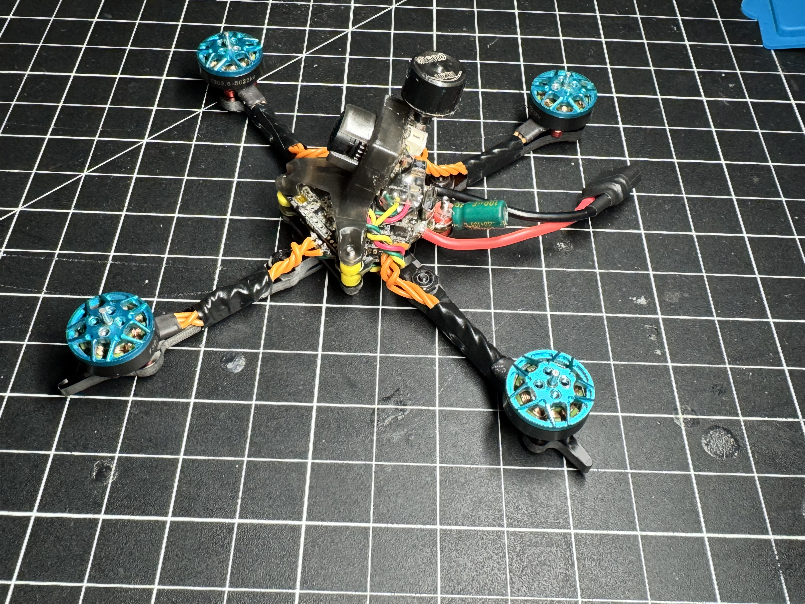

# Hyper Analog

<p align="center">
  
  
</p>


3-inch 3S build on a Kabab FPV Toothpick 3 (TP3) frame, named for its Pyrodrone Hyperlite 1303.5 5022KV motors. Planning, collecting spare parts.

| Spec | Detail |
| --- | --- |
| Status | Planning, collecting spare parts. Betaflight 2026.6.2 on MATEKF411; Bluejay 0.21.0; maiden flight 2026-11-18. PID/rates/OSD still to tidy |
| Frame | Kabab FPV Toothpick 3 (TP3). 3-inch props. The listing says it accepts a 1"×1" typical whoop mounting platform; exact hole spacing is not stated there. About 11–12 g built with hardware; 1.5 mm body plates, 3 mm arms. On hand: TBD. The SoloGood Fi-135 is a spare and is not used on this build |
| Motors | Pyrodrone Hyperlite 1303.5 5022KV ×4 (2–4S, discontinued). On hand, confirm |
| FC/ESC | DarwinFPV F411 AIO, a spare from a DarwinFPV BabyApe Pro V4. STM32F411, 25.5×25.5 mm mount, fit-checked on the Fi-135 (that frame is now spare). ESC 15A continuous / 17A burst, EFM8BB21, Bluejay 0.21.0 on layout S-H-50 (was BLHeli_S 16.7). 1–3S only. 5V/2A BEC. Onboard analog OSD (AT7456E). On hand. The HDZero Gamma 45A AIO is still reserved for a later 3.5-inch 6S build, not this one |
| VTX | PandaRC VT5804 analog VTX, already attached to the Darwin board, with an analog camera on this build. Band B, channel 4, 5790 MHz, power level 3 (100 mW), low power disarm on. UART2 is TBS SmartAudio. The DJI O4 Air Unit is a spare / for other builds and is not used on Hyper |
| RX | ExpressLRS 2.4 GHz EP2 RX nano (SX1280) on UART1 via CRSF. RadioMaster Pocket is the ELRS radio |
| Battery | 3S, capacity TBD |
| Props | 3-inch 2-blade, 3018/3020 class. 5022KV is high for aggressive triblades on 3S |
| AUW | TBD. I will weigh it before the first flight. On a recreational flight, 250 g (0.55 lb) or less means I don't register or broadcast Remote ID. More than 250 g means I register, mark, and broadcast, or fly at a FRIA. |
| Operating mode | Recreational by default. I only fly this aircraft under Part 107 for a project. |
| Remote ID | I have not chosen the hardware yet. If I fly it recreationally at 250 g (0.55 lb) or less, I don't register it and don't broadcast Remote ID. If it weighs more than 250 g, I register it, mark the registration number on the outside, and broadcast with built-in Standard Remote ID or a module, unless I fly at a FRIA, stay inside the boundary, and keep it in sight. Under Part 107 I register and broadcast at any weight. |
| Betaflight config | See Betaflight & ESC setup and Full CLI config below. Link `configs/betaflight/hyper/` here once a dump exists |
| Brain note | The full parts list with prices lives in my private notes |

## Firmware

I flashed Betaflight 4.5.5 with build options CRSF, OSD Digital, and DSHOT, plus the defaults, with full chip erase on. The board was previously on Betaflight 4.2.5 with the MATEKF411 target. OSD Digital was for the earlier DJI O4 plan. This build now uses the board's onboard analog OSD (AT7456E), so I will use analog OSD in Betaflight.

The DARWINF411 target did not detect the gyro. `status` showed `SPI:0`, `Gyros detected: locked`, and the arming flag `NOGYRO`. Reflashing with the MATEKF411 target fixed it; the gyro now works. Use MATEKF411 for this board.

Planned wiring:

- UART1 = ExpressLRS 2.4 GHz EP2 RX nano (SX1280) via CRSF
- UART2 is no longer needed for MSP DisplayPort (the O4 is not on this build)
- VTX control (SmartAudio / IRC Tramp) wiring and UART: TBD
- OSD: onboard analog OSD (AT7456E); use analog OSD in Betaflight

The old 4.2.5 config had gyro alignment CW180. I will verify orientation in the Setup tab.

The 2026-11-18 reflash and current ports, VTX, and ESC setup are under Betaflight & ESC setup below.

## Betaflight & ESC setup

Recorded 2026-11-18.

### Firmware

- Betaflight 2026.6.2, target MATEKF411 (community target) on the Darwin F411 AIO
- Build options: CRSF radio, Analog OSD, DSHOT, VTX, Pin IO
- Recommended to drop GPS, Altitude Hold, Position Hold, LED Strip, and Acro Trainer to save flash
- Full chip erase before flash

### Board alignment and motor remap

- USB faces up (board flipped). `align_board_roll = 180` is correct
- Flipping mirrored motor order, so I remapped motors: 1 B06, 2 B07, 3 B04, 4 B05 (original was 1 B04, 2 B05, 3 B06, 4 B07)
- Props-in layout kept (`yaw_motors_reversed` off)
- It flipped on arm before the remap. Maiden flight was 2026-11-18 after the remap
- `small_angle` 180 is intentional; turtle mode (flip over after crash, AUX2) also arms upside down by itself

### Ports

| Port | Setting |
| --- | --- |
| USB VCP | MSP on |
| UART1 | Serial RX (EP2 ELRS, CRSF) at 115200 |
| UART2 | Peripheral VTX (TBS SmartAudio) at 115200. Switch to IRC Tramp if channel changes don't follow |

### Modes

- Arm on AUX1 (1700–2100)
- Flip over after crash (turtle) on AUX2 (1700–2100)
- To use turtle: AUX2 on, then arm, stick to flip; disarm, AUX2 off, re-arm to fly

### VTX

- PandaRC VT5804 AIR
- Band B, channel 4, 5790 MHz, power level 3 (100 mW)
- `vtx_low_power_disarm = ON`
- Power from VBAT (6–26 V input, not 5V)
- VTX table is in Full CLI config below

### CPU load

OSD CPU overload persisted at `pid_process_denom = 2`. Current fix (2 kHz PID on an 8 kHz gyro):

```
set pid_process_denom = 4
set gyro_lpf2_static_hz = 0
set dyn_notch_count = 1
set dyn_notch_q = 500
save
```

`status` shows CPU 24% (gyro MPU6000, 108 MHz).

### Rates

Actual rates: center 200 (`rc_rate` 20), max 670 deg/s roll/pitch (default srate), yaw srate 60, expo 54 on all axes. PID/filter tune and rates are still TODO; I'll use blackbox later.

### ESC

- Was BLHeli_S 16.7, layout S-H-50
- Flashed Bluejay 0.21.0 at 48 kHz via [ESC Configurator](https://esc-configurator.com/)
- Motor directions: M1 Reversed, M2 Normal, M3 Reversed, M4 Normal
- `motor_poles = 12`

| Setting | Value |
| --- | --- |
| Startup power min / max | 1010 / 1020 |
| Timing | 22.5° (MediumHigh) |
| Demag | Low |
| RPM power protection | 9x |
| Beep | 40 |
| Beacon | 80 |
| Beacon delay | 10 min |
| Power rating | 2S+ |
| Temp protection | Disabled |
| Brake on stop | Off |
| Max brake | 255 |

### Bidirectional DShot

DSHOT300, bidirectional DShot on. `dshot_telemetry_info` at idle:

- 0.00% invalid packets on all 4 motors
- ESC temp telemetry 20–31 °C

### Still to do

- Confirm the RPM filter is on
- OSD tidy
- Battery and failsafe
- PID tune and rates (blackbox later)

## Next steps

Remaining setup is listed under Betaflight & ESC setup.

## Photos

I store photos in the `images/` folder next to this README and link them with relative paths; I keep each image under ~1 MB.

<p align="center">
  
  
</p>

## Parts list (copy/paste)

Caption I can paste to Instagram or X:

```text
Hyper 3S toothpick
Frame: Kabab FPV Toothpick 3 (TP3)
FC/ESC: DarwinFPV F411 AIO 15A (Bluejay 0.21.0)
Motors: Pyrodrone Hyperlite 1303.5 5022KV
RX: ELRS EP2 nano
VTX: PandaRC VT5804 AIR (analog)
Firmware: Betaflight 2026.6.2
Battery: 3S
Props: 3-inch 2-blade, 3018/3020 class
#fpv #fpvdrone #toothpick #betaflight #expresslrs
```

## Build log

- 2026-11-16: Build started. Parts list opened.
- 2026-11-16: I chose the spare Darwin F411 AIO and flashed Betaflight 4.5.5. DARWINF411 did not detect the gyro; MATEKF411 does. I will use MATEKF411 for this board.
- 2026-11-17: I switched the frame to the Kabab FPV Toothpick 3 (TP3). The receiver is an ExpressLRS 2.4 GHz EP2 RX nano (SX1280) on UART1 via CRSF. Video is the PandaRC VT5804 already attached to the Darwin board, with an analog camera. The Fi-135 and the O4 are spares and are not used on Hyper.
- 2026-11-18: I reflashed Betaflight 2026.6.2 (MATEKF411, Analog OSD), loaded the VT5804 VTX table, and set UART2 to TBS SmartAudio. I flashed Bluejay 0.21.0 at 48 kHz and verified bidirectional DShot.
- 2026-11-18: Flipping the board mirrored motor order, and it flipped on arm. I remapped motors (1 B06, 2 B07, 3 B04, 4 B05) and kept props-in. Maiden flight after the remap. CPU overload persisted at `pid_process_denom` 2; I set denom 4. VTX is band B channel 4 at 100 mW.

## Links

- [Hyperlite 1303.5 5022KV (archived listing)](https://web.archive.org/web/20230201022401/https://pyrodrone.com/products/hyperlite-1303-5-fpv-drone-motor-5022kv)
- [Kabab FPV Toothpick 3 (TP3) frame](https://fpvcycle.com/products/kabab-toothpick-3-tp3-frame)

## PIDs & rates

PIDs are Betaflight 2026.6.2 defaults (untuned). Rates are Actual, center 200, max 670 deg/s roll/pitch and 600 yaw, expo 54.

Dump current values. Betaflight CLI `get` does a substring match, so these work:

```
profile 0
get p_
get i_
get d_
get f_
get d_max
rateprofile 0
get rc_rate
get srate
get expo
get rates_type
```

`diff profile` and `diff rates` show only changed values.

Current PID/rates diff:

```
# PIDs: defaults (paste diff profile here after tuning)
rateprofile 0
set roll_rc_rate = 20
set pitch_rc_rate = 20
set yaw_rc_rate = 20
set roll_expo = 54
set pitch_expo = 54
set yaw_expo = 54
set yaw_srate = 60
```

## Full CLI config

Reproduce this config from a fresh Betaflight 2026.6.2 MATEKF411 flash (after defaults). `defaults` is not needed after a full chip erase. `acc_calibration` is board-specific, so recalibrate the accelerometer instead of pasting it; that is why it is omitted. ESC settings (Bluejay 0.21.0, M1/M3 reversed) are set in ESC Configurator, not CLI. `small_angle` 180 is intentional; turtle mode (flip over after crash, AUX2) also arms upside down by itself.

```
resource MOTOR 1 NONE
resource MOTOR 2 NONE
resource MOTOR 3 NONE
resource MOTOR 4 NONE
resource MOTOR 1 B06
resource MOTOR 2 B07
resource MOTOR 3 B04
resource MOTOR 4 B05
feature TELEMETRY
feature OSD
serial UART1 64 115200 57600 0 115200
serial UART2 2048 115200 57600 0 115200
aux 0 0 0 1700 2100 0 0
aux 1 35 1 1700 2100 0 0
vtxtable bands 5
vtxtable channels 8
vtxtable band 1 BOSCAM_A A CUSTOM  5865 5845 5825 5805 5785 5765 5745 5725
vtxtable band 2 BOSCAM_B B CUSTOM  5733 5752 5771 5790 5809 5828 5847 5866
vtxtable band 3 BOSCAM_E E CUSTOM  5705 5685 5665    0 5885 5905    0    0
vtxtable band 4 FATSHARK F CUSTOM  5740 5760 5780 5800 5820 5840 5860 5880
vtxtable band 5 RACEBAND R CUSTOM  5658 5695 5732 5769 5806 5843 5880 5917
vtxtable powerlevels 5
vtxtable powervalues 25 100 200 400 600
vtxtable powerlabels 25 50 100 200 400
set gyro_lpf2_static_hz = 0
set dyn_notch_count = 1
set dyn_notch_q = 500
set dshot_bidir = ON
set motor_poles = 12
set align_board_roll = 180
set small_angle = 180
set gyro_cal_on_first_arm = ON
set pid_process_denom = 4
set osd_tim_1_pos = 384
set osd_tim_2_pos = 2432
set osd_vtx_channel_pos = 2058
set osd_warnings_pos = 14728
set osd_avg_cell_voltage_pos = 2400
set osd_displayport_device = MAX7456
set vtx_band = 2
set vtx_channel = 4
set vtx_power = 3
set vtx_low_power_disarm = ON
set vtx_freq = 5790
set craft_name = Hyper 3S
rateprofile 0
set roll_rc_rate = 20
set pitch_rc_rate = 20
set yaw_rc_rate = 20
set roll_expo = 54
set pitch_expo = 54
set yaw_expo = 54
set yaw_srate = 60
save
```
